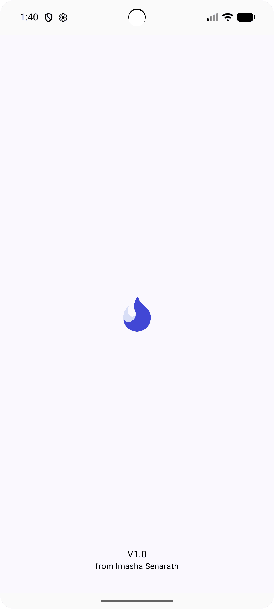
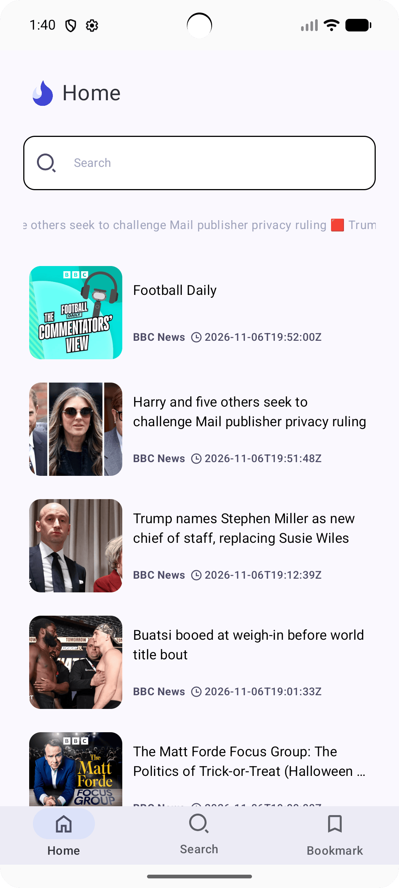
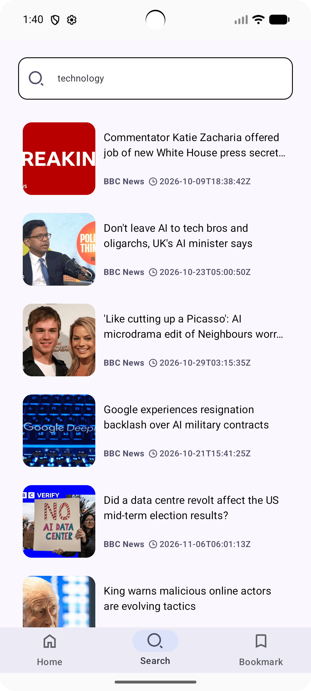
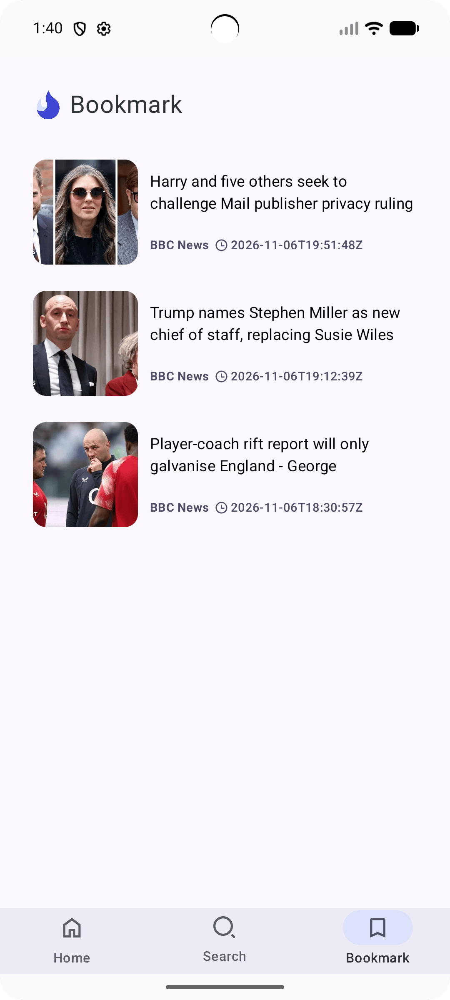

<h1> InfoTap </h1>

A news application that keeps you updated with the latest headlines and news. Built with Kotlin, Jetpack Compose, MVVM, and Clean Architecture to provide a modern and seamless browsing experience.

<h2> ⚙️ Technologies </h2>
<ul>
  <li>Kotlin with MVVM Architecture.</li>
  <li>Jetpack libraries, including ViewModel and Navigation Compose.</li>
  <li>Kotlin Coroutines and StateFlow for asynchronous operations and state   management.</li>
  <li>Retrofit for REST API integration.</li>
  <li>Room database for local data storage.</li>
  <li>Dependency injection using Hilt.</li>
  <li>Paging 3 for efficient loading and displaying paginated content.</li>
  <li>DataStore Preferences for storing application preferences.</li>
  <li>Image loading and caching using Coil.</li>
</ul>

<h2> 🔥 Features </h2>
<ul>
  <li>Browse the latest news and headlines.</li>
  <li>Search for news articles.</li>
  <li>Save articles for later access.</li>
</ul>

<h2>🛢️ Set Up Database</h2>

This project uses Firebase, but the current Firebase account has been disabled due to spamming, so the app won’t work. To make it functional, create a new Firebase project, add the Android app, and generate the google-services.json file. Place it in the app/ directory. Then, enable Email Authentication, Realtime Database, and Cloud Storage in your Firebase project.

  
<h2> 📸 Screenshots </h2>

 

 

 

To see all screenshots, check the "ss" folder.

<h2> 👽 Author </h2>
<a href="https://www.imashasenarath.com/" target="_blank"><strong>Imasha Senarath</strong></a>

<h2> © Credits </h2>

All icons, images, and other media used in this project are the property of their respective copyright owners. Their rights are fully acknowledged and respected.
